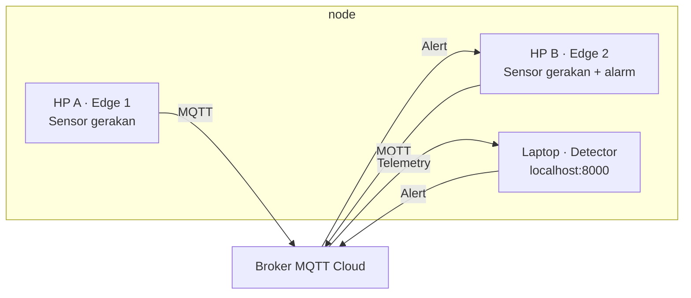

# PocketGuard IoT

Contoh proyek IoT untuk belajar: **2 HP sebagai edge**, **accelerometer + gyroscope**, **2 proses pengolahan data**, **MQTT Cloud**, dan **dashboard di laptop**. Data berasal dari sensor fisik — bukan simulator.


## Sensor Playground (mode baru, tanpa membuat project)

Klik **Buka Sensor Playground** pada halaman yang sama, atau buka URL dengan `?mode=playground`.

- Pilih sensor: **accelerometer, gyroscope, orientation, GPS, microphone RMS** (sesuai kemampuan browser).
- Isi **Device ID**, alamat **MQTT broker WSS** dan **topic** yang kamu inginkan.
- Klik **Start sensor sender**; Safari iPhone atau Chrome Android akan meminta izin jika dibutuhkan.
- Lihat **JSON sensor real-time**, lalu pakai MQTTX / procecing lainnya untuk subscribe ke topic yang sama.
- Tombol **Kembali ke PocketGuard** mengembalikan tampilan semula.

Tidak perlu Termux, QR pairing, flow builder, atau registrasi proyek. Ini **mode sensor umum**, terpisah dari deteksi pencurian PocketGuard. GPS default off; jangan kirim lokasi pribadi ke broker publik.

[**Panduan lengkap Sensor Playground**](docs/SENSOR_PLAYGROUND.md)

## Cara kerja



HP A bergerak sedangkan HP B diam → detector mengirim **ALERT**. Kedua HP bergerak bersamaan → `COMMON_MOTION`.

## 1. Laptop — jalankan detector & dashboard

Pastikan sudah ada **Python 3.10+** dan internet.

```bash
git clone https://github.com/myudak/contoh-project-iot1.git
cd contoh-project-iot1
python -m pip install -r requirements.txt
```

Buat konfigurasi dari `.env.example`:

```bash
cp .env.example .env
```

*Di Windows PowerShell, gunakan `Copy-Item .env.example .env`.*

Ganti `PROJECT_ID` di `.env` menjadi nama kelompok yang unik, misalnya `iot_kelompok_07`. Default memakai broker publik HiveMQ (tanpa akun, **jangan kirim data rahasia**).

```bash
python detector.py
```

Buka **http://localhost:8000** di laptop. Dashboard otomatis membaca konfigurasi broker publik dan PROJECT_ID dari laptop.

## 2. HP A dan HP B — pilih salah satu cara

### Opsi A: Browser HP (tanpa Termux)

1. Publish folder `web-edge/` ke **hosting HTTPS** (contohnya Netlify Drop atau GitHub Pages). Buka link HTTPS tersebut di **dua HP**.
2. Pilih **Edge 1** di HP A, **Edge 2** di HP B.
3. Isi `PROJECT_ID` sama persis dengan di laptop.
4. Tekan **Mulai membaca sensor**, lalu berikan izin gerak jika diminta.

Browser akan memproses data accelerometer + gyroscope dan mengirimnya lewat **MQTT over WebSocket**. Perangkat harus mendukung `DeviceMotionEvent` dan memberi data gyroscope; jika tidak tersedia, gunakan Opsi B.

**[Panduan browser & hosting HTTPS →](docs/BROWSER_EDGE.md)**

### Opsi B: Termux + Python pada 2 HP Android

Pada kedua HP: install Termux + Termux:API, clone repo, install dependensi, lalu samakan `PROJECT_ID` dengan laptop.

**HP A:**
```bash
python hp_dijaga.py
```

**HP B:**
```bash
python hp_pemilik.py
```

Jalankan di **dua HP fisik**, bukan dua terminal laptop. **[Panduan Termux →](docs/ANDROID.md)**

## 3. Coba sistemnya

Letakkan kedua HP di meja yang sama. Saat HP A diangkat dan HP B diam, dashboard berubah menjadi `ALERT`. Pada HP B, notifikasi/getar tersedia lewat Termux; pada opsi browser tampil alert di halaman dan getar jika browser mendukungnya.

**Semua perangkat harus berada dalam satu Wi-Fi/hotspot dan terhubung internet.** Dashboard `localhost` hanya di laptop. Simulator masih ada untuk debugging, tetapi **tidak dihitung sebagai edge fisik**.

## Pelajari kodenya

- `detector.py` → NODE 3 (laptop + localhost dashboard)
- `hp_dijaga.py` → NODE 1 (sensor HP A lewat Termux)
- `hp_pemilik.py` → NODE 2 (sensor HP B + alarm)
- `web-edge/index.html` → alternatif NODE 1 / NODE 2 via browser
- `shared/processing.py` → dua data processing (RMS dan rotasi)
- `nodes/detector_service/rules.py` → algoritma sensor fusion

Dokumentasi: [Arsitektur](docs/ARCHITECTURE.md) · [MQTT](docs/SETUP.md) · [Algoritma](docs/LEARNING.md) · [Dashboard](docs/DASHBOARD.md) · [Security](docs/SECURITY.md).

> Proyek pembelajaran, bukan sistem anti-pencurian produksi. Perangkat/browser bisa memiliki sensor atau izin yang berbeda. Broker publik tidak menyediakan autentikasi/ACL untuk topik kelompok.

### HP tidak terdeteksi bergerak?

- **Browser:** cek indikator event motion, accelerometer, gyroscope, dan jumlah pesan MQTT pada halaman. Ikuti [debug browser](docs/BROWSER_EDGE.md).
- **Termux:** jalankan `python -m scripts.check_sensors` sebelum menyalakan broker dan `python hp_dijaga.py --debug-sensors` untuk mencetak data mentah. Ikuti [debug Android](docs/ANDROID.md).
- Alarm hanya muncul bila kedua edge + detector berjalan, proyek/namespace MQTT sama, dan HP A bergerak sementara HP B relatif diam.
