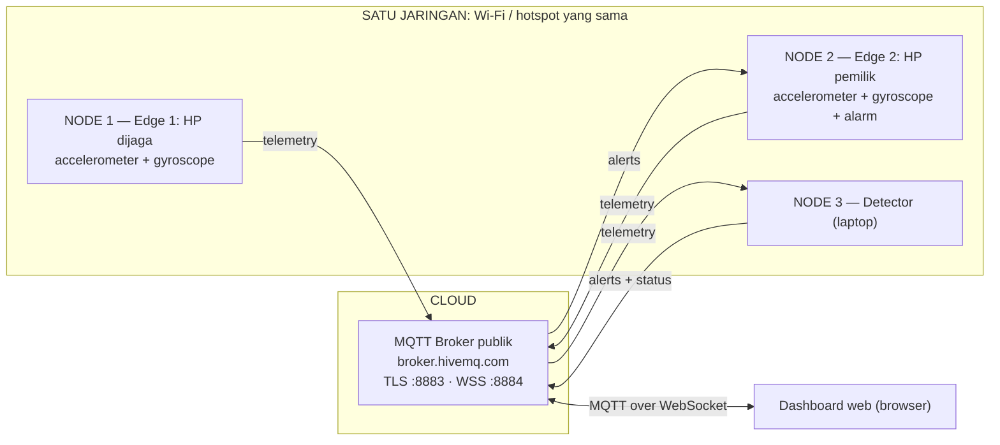

# PocketGuard IoT — Contoh Proyek IoT Anti-Pencurian HP

Contoh proyek untuk tugas IoT: **2 edge device, 2 sensor, 2 data processing, 1 algoritma, MQTT ke cloud, dan dashboard web**. Setiap node dipisah ke foldernya sendiri supaya mudah dipelajari.

> ⚠️ **Hanya contoh belajar.** Ide PocketGuard tidak boleh dipakai ulang sebagai proyek kelompok. Gerakan mencurigakan juga **bukan bukti pencurian**.


## Ide singkat

HP A (yang dijaga) dan HP B (milik pemilik) diletakkan di meja yang sama. Keduanya mengirim data gerakan ke broker MQTT di cloud. Detector membandingkan keduanya:

| HP A | HP B | Keputusan | Artinya |
|---|---|---|---|
| diam | diam | `NORMAL` | aman |
| **bergerak** | diam | **`ALERT`** | HP A diangkat orang → HP B bergetar |
| bergerak | bergerak | `COMMON_MOTION` | meja terguncang / dibawa pemilik, bukan alarm |

## Arsitektur



| Persyaratan tugas | Di proyek ini |
|---|---|
| 3 orang | Edge · Processing & Algoritma · Cloud & Dashboard ([pembagian kerja](docs/GITHUB.md)) |
| 2 edge device | HP A menjalankan `edge1`, HP B menjalankan `edge2` |
| 2 sensor | Accelerometer + gyroscope di setiap HP |
| 2 data processing | RMS percepatan + integrasi rotasi ([LEARNING.md](docs/LEARNING.md)) |
| Algoritma | Rule-based sensor fusion: bandingkan gerakan dua edge |
| Protokol & cloud | MQTT over TLS ke broker cloud (HiveMQ public broker), MQTT over WebSocket untuk dashboard |
| Satu jaringan | Kedua HP (dan laptop detector) di Wi-Fi/hotspot yang sama |

## Struktur folder

```text
contoh-project-iot1/
├── nodes/
│   ├── edge1_protected/main.py      NODE 1: HP yang dijaga
│   ├── edge2_guardian/main.py       NODE 2: HP pemilik (alarm getar + notifikasi)
│   ├── detector_service/main.py     NODE 3: subscribe telemetry, publish alert & status
│   ├── detector_service/rules.py    Algoritma deteksi (tanpa MQTT, mudah dites)
│   └── monitor/main.py              Monitor alert di terminal (opsional)
├── shared/
│   ├── sensors.py                   Sensor Android (Termux:API) atau simulator
│   ├── processing.py                Dua data processing
│   ├── messages.py                  Format JSON telemetry & status
│   ├── mqtt_connection.py           Koneksi ke broker cloud (TLS)
│   ├── edge_runner.py               Loop edge: sensor → processing → MQTT
│   └── alarm.py                     Output HP B: getar + notifikasi
├── dashboard/index.html             Dashboard web, satu file, tanpa server
├── scripts/                         offline_demo, send_control, replay_test
├── tests/                           Unit test
└── docs/                            Penjelasan lengkap + diagram
```

## 1. Coba tanpa HP dan tanpa broker

Python **3.10+**:

```bash
python -m pip install -r requirements.txt
python -m scripts.offline_demo
python -m unittest discover -s tests -v
```

Hasil yang diharapkan: `NORMAL` → `ALERT` → `COMMON_MOTION` → `NORMAL`. Ini hanya simulasi algoritma; **belum memenuhi syarat hardware dan cloud**.

## 2. Jalankan dengan broker cloud (simulator di laptop)

Broker default adalah **broker publik HiveMQ** (tanpa daftar akun). Cukup:

```bash
cp .env.example .env      # ganti PROJECT_ID dengan nama unik kelompokmu
```

Buka 3 terminal:

```bash
python -m nodes.detector_service.main                                       # NODE 3
python -m nodes.edge2_guardian.main --source simulator --scenario still     # NODE 2
python -m nodes.edge1_protected.main --source simulator --scenario pickup   # NODE 1
```

Lalu buka `dashboard/index.html` di browser ([DASHBOARD.md](docs/DASHBOARD.md)).

ARM / DISARM bisa lewat tombol dashboard atau:

```bash
python -m scripts.send_control DISARM
python -m scripts.send_control ARM
```

## 3. Jalankan di 2 HP Android sungguhan

Untuk memenuhi syarat 2 edge fisik, jalankan Edge 1 dan Edge 2 di **dua HP terpisah** dengan `--source android`. Langkah lengkapnya ada di [docs/ANDROID.md](docs/ANDROID.md).

## Dokumentasi

1. [ARCHITECTURE.md](docs/ARCHITECTURE.md) — node, alur data, diagram.
2. [LEARNING.md](docs/LEARNING.md) — sensor, RMS, integrasi rotasi, algoritma.
3. [SETUP.md](docs/SETUP.md) — broker, `.env`, topic MQTT.
4. [ANDROID.md](docs/ANDROID.md) — Termux & Termux:API di 2 HP.
5. [DASHBOARD.md](docs/DASHBOARD.md) — dashboard web lewat MQTT over WebSocket.
6. [SECURITY.md](docs/SECURITY.md) — TLS, ACL, lab replay.
7. [GITHUB.md](docs/GITHUB.md) — clone, pembagian kerja, tests.

## Batasan

- Algoritma **rule-based** dengan threshold awal, bukan model machine learning terlatih.
- Pembacaan sensor via Termux:API cukup lambat; gerakan sangat singkat bisa terlewat.
- Alarm HP B memakai `termux-vibrate` dan `termux-notification`; di laptop alarm hanya tercetak di terminal.
- Belum ada heartbeat per HP. Dashboard menandai edge "Offline" bila >10 detik tanpa data.
- TLS melindungi jalur komunikasi, **bukan kebenaran data sensor** yang dikirim client.
- Bukan sistem anti-pencurian siap produksi.

MIT License · Proyek pembelajaran IoT.
