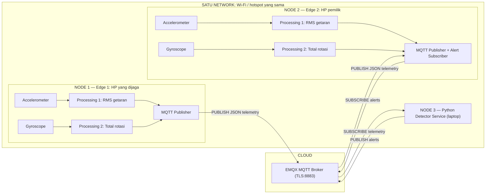

# PocketGuard IoT — Contoh Proyek IoT Anti-Pencurian HP

**Contoh belajar IoT lengkap:** 3 orang, 2 edge device, 2 sensor, 2 proses data, MQTT over TLS, dan cloud broker. Repository ini dibuat supaya setiap **node** terlihat dan bisa dipelajari terpisah, bukan sebagai satu file besar.

> **Status:** simulator + unit test tersedia. Live MQTT membutuhkan broker dan kredensial sendiri; sensor Android asli harus diuji pada masing-masing HP. Gerakan mencurigakan **bukan bukti pencurian**.

## 1. Arsitektur: node mana melakukan apa?



**Penting:** yang berada pada cloud di setup awal adalah **broker MQTT**. Detector berjalan di laptop, dan kedua HP berada dalam satu jaringan. Detector dapat dipindahkan ke VM cloud jika diperlukan.

## 2. Peta source code

```text
contoh-project-iot1/
├── nodes/
│   ├── edge1_protected/main.py      NODE 1: HP yang dijaga
│   ├── edge2_guardian/main.py       NODE 2: HP pemilik + alarm
│   ├── detector_service/main.py     NODE 3: MQTT subscriber & alert publisher
│   ├── detector_service/rules.py    Aturan pengambilan keputusan
│   └── monitor/main.py             Monitor terminal opsional
├── shared/
│   ├── sensors.py                   Input sensor HP atau simulator
│   ├── processing.py                Dua data processing
│   ├── messages.py                  Skema JSON telemetry
│   ├── mqtt_connection.py           Koneksi ke broker cloud
│   └── edge_runner.py               Loop sensor -> MQTT
├── scripts/
│   ├── offline_demo.py              Coba tanpa sensor dan cloud
│   ├── send_control.py              Kontrol ARM / DISARM
│   └── replay_test.py               Lab replay message di broker sendiri
├── tests/                            Unit tests
├── docs/                             Diagram dan penjelasan lengkap
├── .env.example                      Contoh konfigurasi (tanpa password asli)
└── requirements.txt
```

| Persyaratan tugas | Letak implementasi |
|---|---|
| 3 orang | Edge / Processing & Algorithm / Cloud & Security |
| 2 edge | HP A menjalankan `edge1`; HP B menjalankan `edge2` |
| 2 sensor | Accelerometer + gyroscope pada masing-masing HP |
| 2 data processing | RMS acceleration + integrasi total gerakan rotasi |
| Algoritma | Rule-based sensor fusion, bandingkan gerakan kedua edge |
| Protokol & cloud | MQTT over TLS, EMQX Cloud |
| Satu network | Kedua HP di Wi-Fi/hotspot yang sama |

## 3. Mulai belajar tanpa MQTT

Python **3.10+**:

```bash
python -m scripts.offline_demo
python -m unittest discover -s tests -v
```

Ekspektasi: diam -> `NORMAL`, HP dijaga bergerak sendirian -> `ALERT`, kedua HP bergerak -> `COMMON_MOTION`.

**Offline demo hanyalah simulasi algoritma; belum memenuhi bagian hardware dan cloud tugas.**

## 4. Jalankan MQTT (3 terminal)

Setelah menyiapkan broker sesuai [docs/SETUP.md](docs/SETUP.md):

```bash
python -m pip install -r requirements.txt
cp .env.example .env
```

Isi `.env` sendiri: `MQTT_HOST`, `MQTT_USERNAME`, `MQTT_PASSWORD`, dan `PROJECT_ID`.

**Terminal 1 — NODE 3 / detector:**

```bash
python -m nodes.detector_service.main
```

**Terminal 2 — NODE 2 / guardian:**

```bash
python -m nodes.edge2_guardian.main --source simulator --scenario still
```

**Terminal 3 — NODE 1 / protected:**

```bash
python -m nodes.edge1_protected.main --source simulator --scenario pickup
```

Ini bisa disimulasikan seluruhnya dari laptop. Untuk memenuhi syarat 2 edge fisik, pindahkan Edge 1 dan Edge 2 ke **dua HP Android terpisah** sesuai [docs/ANDROID.md](docs/ANDROID.md).

Untuk kontrol penjagaan:

```bash
python -m scripts.send_control DISARM
python -m scripts.send_control ARM
```

## 5. Cara memahami kode

1. [ARCHITECTURE.md](docs/ARCHITECTURE.md) — node, alur, diagram Mermaid.
2. [LEARNING.md](docs/LEARNING.md) — accelerometer, gyroscope, RMS, integrasi rotasi, rule deteksi.
3. [SETUP.md](docs/SETUP.md) — broker cloud, topic dan payload MQTT.
4. [ANDROID.md](docs/ANDROID.md) — menggunakan 2 HP sungguhan dengan Termux:API.
5. [SECURITY.md](docs/SECURITY.md) — eksperimen replay, ACL, spoofing pada broker sendiri.
6. [GITHUB.md](docs/GITHUB.md) — clone, pembagian kerja kelompok, dan tests.

Diagram mentah: [arsitektur](docs/diagram.mmd) · [sequence MQTT](docs/sequence.mmd).

## 6. Batasan demonstrasi

- Tidak ada model machine learning terlatih: algoritmanya **rule-based**.
- Kode real sensor memakai Termux:API low-rate; hasil bisa berbeda menurut HP dan pengaturan Android.
- Alarm muncul sebagai output terminal di HP pemilik, **bukan push notification Android**.
- Sistem belum punya heartbeat timeout saat HP hilang koneksi.
- Hasil detector bergantung pada gerakan dua HP, posisi penempatan, dan threshold; masih mungkin false positive/negative.
- TLS melindungi koneksi, **tidak menjamin kebenaran fisik** sensor yang dikirim oleh client.
- Jangan gunakan sebagai sistem anti-pencurian produksi.

MIT License · Proyek pembelajaran IoT.
