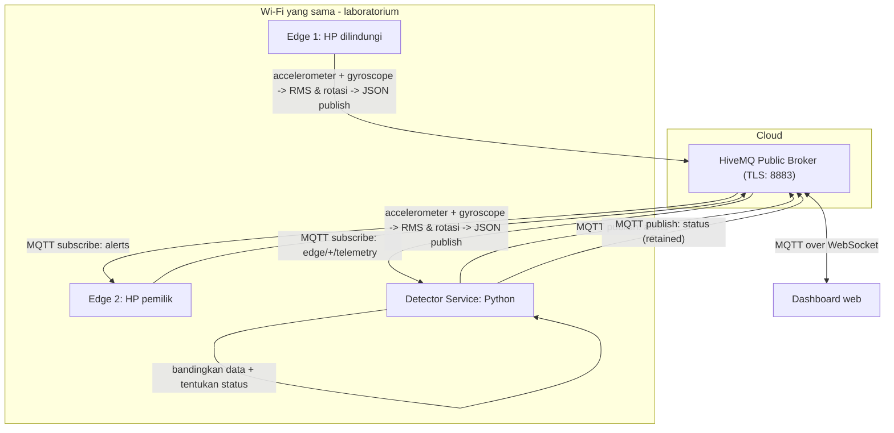
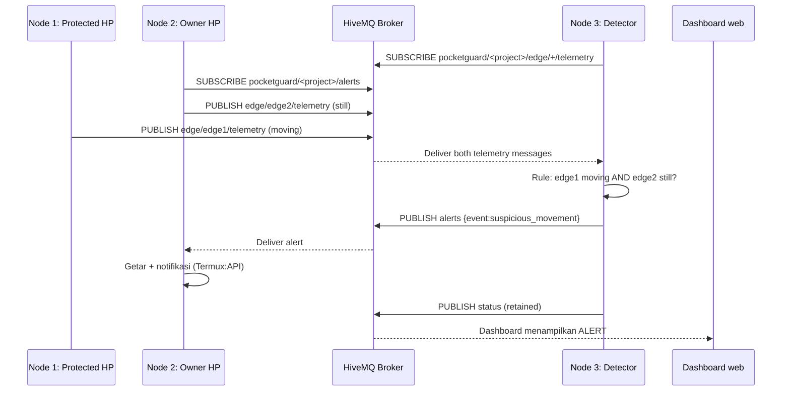

# Arsitektur dan diagram Mermaid

## Alur lengkap

## Sequence ketika HP diangkat

## Node responsibilities

| Node | Input | Process | Output | Source code |
|---|---|---|---|---|
| Edge 1 | Accelerometer & gyro | RMS & angular integration | MQTT telemetry Edge 1 | `nodes/edge1_protected/main.py` |
| Edge 2 | Accelerometer & gyro | RMS & angular integration | MQTT telemetry Edge 2, getar + notifikasi saat alert | `nodes/edge2_guardian/main.py`, `shared/alarm.py` |
| Detector service | Both MQTT topics | Pair latest readings + detection rule | MQTT alert + status | `nodes/detector_service/` |
| Dashboard web | Telemetry, status, alerts | Menampilkan data & grafik | MQTT control (ARM/DISARM) | `dashboard/index.html` |
| HiveMQ public broker | MQTT packets | Routes publish to subscribers | MQTT packets | External public broker (cloud) |
| Monitor (optional) | Alert MQTT topic | Prints events | Terminal log | `nodes/monitor/main.py` |

**Interpretasi syarat satu network:** kedua edge pada hotspot/Wi-Fi yang sama. Cloud broker memang berada di luar LAN dan diakses via internet. Detector pada setup dasar berada di laptop, bukan VM cloud; bisa dipindahkan ke cloud jika perlu.
