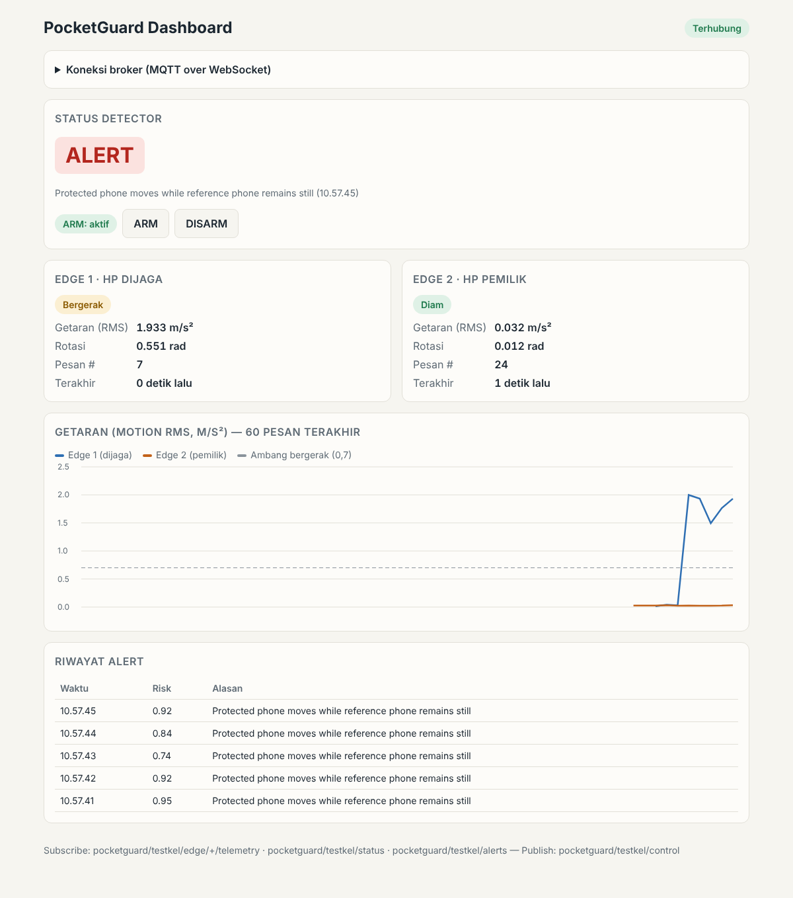

# Dashboard web (MQTT over WebSocket)



`dashboard/index.html` adalah **satu file HTML** tanpa server dan tanpa instalasi. Dashboard ini:

- menampilkan status detector (`NORMAL`, `ALERT`, `COMMON_MOTION`, `DISARMED`, …),
- menampilkan getaran dan rotasi terbaru dari Edge 1 dan Edge 2, plus grafik 60 pesan terakhir,
- mencatat riwayat alert,
- punya tombol **ARM / DISARM** (publish ke topic `control`).

Dashboard **bukan edge device** dan tidak dihitung sebagai sensor. Dashboard hanya subscriber dan publisher MQTT lain.

## Kenapa WebSocket?

Browser tidak bisa membuka koneksi TCP biasa ke port MQTT `8883`. Karena itu broker cloud juga menyediakan **MQTT over WebSocket** (`wss://`). Pesan, topic, dan broker tetap sama, hanya "jalan"-nya yang berbeda:

| Client | Protokol | Contoh alamat |
|---|---|---|
| Edge 1, Edge 2, detector (Python) | MQTT over TLS | `xxxx.emqxsl.com:8883` |
| Dashboard (browser) | MQTT over WebSocket + TLS | `wss://xxxx.emqxsl.com:8084/mqtt` |

Port WebSocket umumnya `8084` di EMQX Cloud dan `8884` di HiveMQ Cloud, dengan path `/mqtt`. **Cek halaman koneksi (Overview) di konsol broker kalian**, karena nilainya bisa berbeda.

## Cara membuka

1. Jalankan detector dan kedua edge seperti biasa (lihat [SETUP.md](SETUP.md)).
2. Buka `dashboard/index.html` dengan Chrome/Firefox (klik dua kali file-nya sudah cukup).
3. Isi:
   - **WebSocket URL**: `wss://HOST:8084/mqtt`
   - **PROJECT_ID**: sama persis dengan `.env`
   - **Username / Password** broker
4. Klik **Hubungkan**.

URL, PROJECT_ID, dan username diingat browser. **Password tidak disimpan.**

Opsional: publikasikan folder `dashboard/` lewat **GitHub Pages** agar dashboard bisa dibuka dari HP.

## Topic yang dipakai

```text
SUBSCRIBE pocketguard/<PROJECT_ID>/edge/+/telemetry   data dua edge
SUBSCRIBE pocketguard/<PROJECT_ID>/status             keputusan detector terbaru (retained)
SUBSCRIBE pocketguard/<PROJECT_ID>/alerts             riwayat alert
PUBLISH   pocketguard/<PROJECT_ID>/control            ARM / DISARM
```

Topic `status` dikirim dengan flag **retained**, jadi dashboard yang baru tersambung langsung melihat status terakhir. Kalau detector mati mendadak, broker mengirim **Last Will** `OFFLINE`.

## Keamanan

Password broker diketik di browser. Untuk praktik yang baik, buat **akun khusus dashboard** dengan ACL terbatas (lihat [SECURITY.md](SECURITY.md)). Jangan pakai akun admin, dan jangan menaruh password di dalam file HTML.

## Troubleshooting

| Gejala | Kemungkinan penyebab |
|---|---|
| "Library MQTT.js gagal dimuat" | Tidak ada internet; library diambil dari CDN jsDelivr |
| Tetap "Menghubungkan…" / "Menyambung ulang…" | Port/path WebSocket salah, atau WebSocket belum aktif di broker |
| Terhubung tapi data kosong | `PROJECT_ID` berbeda dengan `.env`, atau ACL menolak subscribe |
| Status `OFFLINE` | Detector tidak berjalan |
| Tombol ARM/DISARM tidak berefek | ACL tidak mengizinkan publish ke `control`, atau detector mati |
