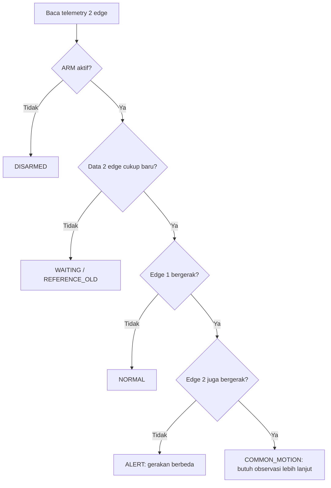

# Bagaimana sensor dan algoritma bekerja?

## 1. Dua sensor per edge

**Accelerometer** membaca percepatan pada sumbu X/Y/Z (m/s²). Ketika HP diam, resultan pembacaannya mendekati **9,81 m/s²** akibat gravitasi.

**Gyroscope** mengukur kecepatan rotasi (rad/s) pada tiga sumbu. Diam ≈ 0; HP diputar menghasilkan nilai lebih besar.

Contoh data mentah (sekadar ilustrasi):

```json
{
  "acceleration": [0.2, 0.1, 10.7],
  "gyroscope": [0.65, 0.1, 0.05]
}
```

## 2. Data processing A: RMS perubahan percepatan

Di `shared/processing.py`:

```text
magnitude = sqrt(ax² + ay² + az²)
error     = magnitude - 9.81
motion_rms = sqrt(mean(error²))
```

Mengapa RMS? Agar getaran positif/negatif tidak saling menghilangkan. **Catatan:** deviasi terhadap 9,81 bukan metode motion tracking lengkap, dan perpindahan lambat pada kecepatan hampir konstan bisa terlewat.

## 3. Data processing B: integrasi rotasi

```text
angular_speed = sqrt(gx² + gy² + gz²)
rotation_rad += angular_speed * delta_t
```

Hasil adalah perkiraan **total banyaknya rotasi selama window**, bukan sudut orientasi absolut yang akurat. Gyroscope drift dan noise dapat memengaruhi nilai.

## 4. Algoritma sensor fusion

Bandingkan dua fitur di atas pada dua HP yang berada di lingkungan fisik sama:



Rule bawaan di `nodes/detector_service/rules.py`:

```text
moving = (motion_rms >= 0.7) OR (rotation_rad >= 0.25)
alert = edge1_moving AND NOT edge2_moving
```

**Threshold hanyalah nilai awal untuk demo**, bukan hasil pelatihan model. Kumpulkan data kondisi diam, digeser, diangkat, meja terguncang, lalu ukur false positive/false negative dan sesuaikan threshold.

## 5. Apa yang dikirim MQTT?

Yang dipublish bukan data mentah tiap sensor, tetapi **hasil dua data processing**:

```json
{
  "device_id": "edge1",
  "boot_id": "6af9e0c9",
  "sequence": 42,
  "sent_at_ms": 1790000000000,
  "motion_rms": 1.28,
  "rotation_rad": 0.74
}
```

Ini membuat message kecil dan menghemat traffic. `boot_id` berubah ketika aplikasi edge dijalankan ulang, `sequence` naik setiap pesan, dan `sent_at_ms` dipakai untuk memeriksa data basi.

## 6. Ide eksperimen mahasiswa

1. Bandingkan RMS saat HP diam vs diangkat vs bergerak perlahan.
2. Uji threshold 0.3, 0.7, 1.2: seberapa banyak alarm palsu?
3. Bandingkan deteksi pakai accelerometer saja, gyroscope saja, dan gabungan.
4. Ubah window 5 sampel menjadi 10: bagaimana latency dan akurasi berubah?
5. Uji ketika kedua HP digerakkan bersamaan: apakah sistem menekan false alarm?
6. [Opsional] Ganti rule dengan Isolation Forest setelah dataset nyata mencukupi; jangan mengklaim ada AI terlatih bila belum dilatih.
